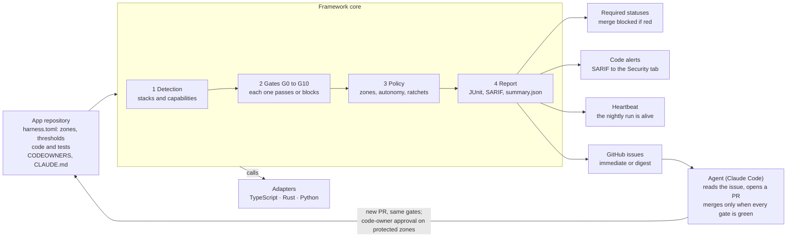

# forge

**A fortified-production framework for any repository, usable by humans and agents alike.**

A "perfect prod" does not exist; what does exist is a prod where nothing gets in without proof and every problem ends up as an issue. This repository orchestrates standard tools rather than writing new ones: eleven blocking gates (G0 to G10), one manifest per repository, a shared policy for agents and alerts, ratcheted thresholds, and four maturity levels to adopt it on any repository without breaking everything.

- **What the repository contains today**: section 1.
- **The framework** (architecture, gates, manifest, policy, report): sections 2 to 4.
- **Writing the tests in an app**: section 5.
- **Setting it up on a repository**: section 6.
- **Why these choices** (research summary): section 7. Details of the gates, tools per ecosystem and lessons learned: [`METHODOLOGY.md`](METHODOLOGY.md).

---

## 1. What the repository contains today

The repository already covers gates G0 to G6 and G8 as reusable workflows, actions and templates (details per gate: [`METHODOLOGY.md`](METHODOLOGY.md)). The rest is planned.

| Framework gate | Where | Status |
| --- | --- | --- |
| G0 Repository hygiene | `actions/hygiene`, `policy/`, `scorecard.yml` | In place: Conftest policy on `harness.toml` and workflows (pinned actions, least privilege), CODEOWNERS owning every protected zone, weekly Scorecard. Checking the live ruleset comes with `harness doctor` |
| G1 Static | G1 job of `pipeline.yml` | In place |
| G2 Unit | G2 job of `pipeline.yml` | In place |
| G3 Integration + authorisation | G3 job of `pipeline.yml`, `probe` | In place (pilot repository) |
| G4 External API contracts | `nightly.yml` | Template, not yet run on a real project |
| G5 Security | `security.yml`, `sast.yml`, `claude-review.yml`, `dast.yml`, `probe` | In place (`dast.yml` not yet run on a real project) |
| G6 End-to-end | G6 job of `pipeline.yml` | Template, not yet run on a real project |
| G7 Mutation | — | Planned |
| G8 Resilience and load | `nightly.yml`, `templates/load/` | Templates, not yet run on a real project |
| G9 Hidden acceptance | — | Planned |
| G10 Production | — | Planned (external monitor, heartbeat) |
| Manifest, policy, single report | `harness.toml`, `templates/harness.toml` | Manifest validated by G0; `summary.json` and the single report planned |

### Contents

| Path | Role |
| --- | --- |
| `stages/check.mjs` | **Code.** Inspects any repository and reports, for each gate (G1 to G6, G8, chain), done / partial / missing, then the next one. `--json` for agents. First version of the future `harness check` |
| `probe/probe.mjs` | **Code.** Black-box attack on any HTTP API: authentication, another user's data, out-of-bounds paths, hostile input, size limits, races, headers, cookies |
| `actions/hygiene` | G0 as a composite action: runs the Conftest policy and the CODEOWNERS check against the calling repository |
| `policy/` | The G0 rules: `manifest/*.rego` (harness.toml), `workflows/*.rego` (pinning, permissions), each with Rego tests, and `codeowners.mjs` (protected zones owned) |
| `ratchet/ratchet.mjs` | **Code.** Holds the line: counts findings (ESLint JSON or any SARIF) per file and rule against `.harness/baseline.json`; only new ones block, and `update` refuses to raise the baseline |
| `harness.toml` | forge's own manifest: forge goes through its own G0 |
| `skills/harden` | Claude Code skill `/harden`: detects the gates in place, implements the next one, proves it in CI |
| `.github/workflows/` | Reusable CI: `security.yml` (gitleaks + audits for npm, pnpm, Cargo, pip, Go; any other lockfile fails the gate), `sast.yml` (Semgrep), `dast.yml` (OWASP ZAP), `claude-review.yml`, and `self.yml`, which puts this repository through its own chain |
| `templates/` | `pipeline.yml` (the chain of gates), `nightly.yml` (contracts + DAST + load, opens an issue), `dependabot.yml`, PR template, gitleaks config, review rules, k6 load test |

`stages/` and `probe/` have no dependencies (Node 18 or later); `policy/codeowners.mjs` reads TOML with `smol-toml` (exact version, lockfile committed, audited in CI). Tests: `node --test probe/probe.test.mjs stages/check.test.mjs policy/codeowners.test.mjs` and `conftest verify --policy policy`, all run by this repository's own chain (G0 → G1 → G2 → G3 → G5).

### Using it

**With Claude Code** (once per machine):

```
/plugin marketplace add beskar-ci/forge
/plugin install forge@forge
```

Then in any project: `/harden` (or "take this project to level 1").

**By hand**:

```sh
node path/to/forge/stages/check.mjs .            # where am I?
node path/to/forge/probe/probe.mjs app.probe.json  # attack the running app
```

The reusable workflows are called like this, pinned to a commit SHA (Dependabot proposes updates):

```yaml
security:
  uses: beskar-ci/forge/.github/workflows/security.yml@<sha>
```

Secrets and variables a project may need: `CLAUDE_CODE_OAUTH_TOKEN` (`claude setup-token`) for the review, `STAGING_URL` for DAST and load, test-account credentials for contract tests.

### What `probe` checks

| Check | Fails when |
| --- | --- |
| Control: a valid request works | a valid request with the owner's credentials (on its own resource for `owned` routes) is refused; the route's other checks are then skipped, since a server refusing everything would pass them. Opt out with `control: false` |
| Auth: missing or forged credentials | a route marked `auth` answers anything other than 401, 403 or 404 |
| Ownership: other user | the second user's request is not denied (reads always; writes unless the route declares `ownership: "scoped"`, i.e. it acts on the user's own copy), returns the owner's data, or changes it. Needs `owned.read` and two users (owner first): otherwise nothing is claimed, and a config with `owned` routes but one user is refused |
| Path escape | an encoded `../`, an absolute path, a NUL or a 4 KB identifier is not refused with a 4xx |
| Hostile input | SQL, HTML or template strings, huge strings or wrong JSON types give a 5xx or are echoed back as is |
| Size limit | the valid body, its single `{fuzz}` field padded to `maxBytes - 1` bytes, is refused, or padded to `maxBytes + 1` is not refused as too large (413, or `tooLargeStatus`) |
| Race | none, or more than `maxSuccess`, of N parallel requests succeed |
| Security headers | `nosniff`, `Referrer-Policy`, clickjacking protection, HSTS on https are missing |
| Cookies | a cookie lacks HttpOnly, Secure or SameSite |
| No server error | a response is a 5xx |

Configuration format: `probe/example.config.json`. `$NAME` or `${NAME}` anywhere in a header value comes from the environment; a missing variable stops the run. Run it against local, a preview or staging, never against production data.

### Verified so far

- Both code tools pass their tests; this repository's CI runs them together with `security.yml` and `sast.yml` on itself.
- A private pilot repository uses `security.yml` and `claude-review.yml` from here (CI green). `probe` ran 17 checks there that passed and found one real issue (no clickjacking protection). `stages/check.mjs` sees G2 and G3 done there, G1 missing.
- **Not yet run on a real project:** `dast.yml`, the staging/G6/production jobs of `pipeline.yml`, `nightly.yml`, the k6 template, the Claude review on a real PR (it needs the token).

---

## 2. The framework

A single "harness" repository, plugged into any app through one configuration file and a ten-line workflow: it orchestrates existing tools, makes every gate blocking, and treats agents as contributors who can touch neither what judges them nor what authorises them.



The app only declares what the tool cannot guess; the core detects, runs the gates through the adapters, applies the policy and publishes a single report, from which the statuses, alerts and issues flow, and an agent can pick those issues up, going back through the same gates.

### Six principles

1. **Orchestrate, don't rewrite.** MegaLinter, Scorecard, Semgrep, Stryker, k6 already do their job; the framework wires them together.
2. **A gate blocks or does not exist.** Every enabled gate is a required status in the ruleset. A warning nobody reads is not a gate.
3. **Every threshold is a ratchet.** Coverage, mutation score, latency budget: they go up, never down, and only a human changes them.
4. **What judges is out of reach of what is judged.** Critical tests, thresholds, workflows and CODEOWNERS are protected; hidden acceptance tests are never visible to an agent.
5. **One manifest per repository, one policy for all.** The app declares its zones, its steady state and its external APIs; the autonomy and alerting rules live in the core.
6. **Adopt without breaking everything.** On an existing repository, the gates "hold the line": they block new problems and inventory the existing ones, to be paid down later.

### The gates

| Gate | What it checks | When | Tools (TS · Rust · Python) |
| --- | --- | --- | --- |
| G0 Repository hygiene | Active ruleset, CODEOWNERS, pinned dependencies, no secret in the code | Every PR + every week | OpenSSF Scorecard, gitleaks, Conftest |
| G1 Static | Format, lint, types | Before commit + every PR | MegaLinter or Trunk; `tsc` · `clippy` · `mypy` |
| G2 Unit | Isolated logic; ratcheted coverage | Every PR | Vitest · `cargo test` · pytest |
| G3 Integration | Real database and services in containers; characterisation tests | Every PR | Testcontainers, Supabase CLI · `sqlx::test` · pytest |
| G4 Contracts | External APIs: recorded responses on PRs, the real API at night | Every PR + every night | MSW · `wiremock` · respx; Pact if you control both sides |
| G5 Security | Code flaws, vulnerable dependencies, the deployed app under attack | Every PR + staging | Semgrep or CodeQL as SARIF, Dependabot, `cargo audit`, Claude review (trusted PRs), OWASP ZAP, `probe` |
| G6 End-to-end | Critical journeys on the preview environment | Every PR | Playwright |
| G7 Mutation | Do the tests catch broken code? Ratcheted score | Incremental on PRs, full at night | Stryker · `cargo-mutants` · mutmut |
| G8 Resilience and load | The steady state holds under injected faults and under load | Every night, on staging | Toxiproxy, k6; `turmoil` for Rust services designed for it |
| G9 Hidden acceptance | Tests the agent has never seen | Agent PRs only | Protected repository or step |
| G10 Production | Availability, error rate, scheduled jobs alive | Continuously | External monitor, steady-state alerts, Healthchecks.io |

---

## 3. The manifest, the only app-specific file

Anything the tool can detect (languages, database, web interface) does not go in it. It only holds human decisions.

```toml
[project]
name = "my-app"
level = 2                      # target maturity level (section 4)

[zones.protected]              # diagnosis only for agents
paths = ["supabase/migrations/**", "lib/auth/**", ".github/**", "tests/critical/**", "harness.toml"]

[zones.standard]               # fix on a PR, merged by the bot once every gate is green
paths = ["**"]

[steady_state]                 # reused by k6, Toxiproxy and production alerts
error_rate_max = 0.01
latency_p95_ms = 800

[ratchets]                     # floor values, raised automatically, never lowered
coverage = 72
mutation_critical = 61

[external_apis.shipping]
fixtures = "tests/fixtures/shipping/"
live_check = "nightly"

[environments]
staging = "https://staging.example.app"
preview = "vercel"

[alerts]
channel = "github-issues"
immediate_label = "alert:immediate"
digest_label = "alert:digest"
```

### The policy, shared by every repository

| Zone | What the agent may do | Who merges |
| --- | --- | --- |
| Protected (auth, migrations, secrets, harness, gates, critical tests, thresholds) | Diagnose; propose the fix on a PR | The bot, only after a code owner (a human gatekeeper) approves: CODEOWNERS owns every protected path, and an approval is dismissed if code is pushed afterwards |
| Standard (everything else) | Fix it on a PR | The bot, as soon as every required gate is green, with no human approval |
| Rules (ruleset, permissions, secrets, visibility) | Nothing: the bot has write access, not admin | A human, explicitly, every time |

The gates are the proof: a green standard PR merges on its own. What judges the code (workflows, tests, policy, CODEOWNERS) can never be changed by the bot alone, so it cannot weaken a gate to get a PR through. Merges are done by the bot's account, so the history does not carry the reviewer's name.

| Event | Level | Channel |
| --- | --- | --- |
| Prod down, errors above the steady state | Immediate | External monitor + `alert:immediate` issue |
| Confirmed security flaw, exposed secret | Immediate | `alert:immediate` issue |
| RLS test or migration red on `main` | Immediate | `alert:immediate` issue |
| Nightly run or scheduled job missing | Immediate | Healthchecks.io |
| Agent stuck after 2 attempts | Daily digest | `alert:digest` issue |
| External API changed (prod intact) | Daily digest | `alert:digest` issue |
| Medium vulnerability, ratchet dropping on a branch | Daily digest | `alert:digest` issue |
| Everything else | No alert | Dashboard and logs |

No email password in the infrastructure: assigned GitHub issues are emailed automatically. This policy is written in Rego and checked by Conftest on every PR: a `harness.toml` that removes a protected zone, lowers a ratchet or disables a gate fails G0.

### The single report

Every gate, whatever the tool, produces one of two standard formats: JUnit XML for tests, SARIF for findings. The core adds a `summary.json` per run (gate, status, metrics, ratchet values). From there come a single PR comment, the alerts in the Security tab, and the labelled issues. Agents only read `summary.json`, never the raw tool output.

### Target layout of this repository and of what it puts in an app

```
harness/                              my-app/ (after harness init)
  .github/workflows/                    .github/workflows/harness.yml   ← calls harness@<sha>
    gate-static.yml  gate-unit.yml      harness.toml
    gate-integration.yml  …             CODEOWNERS
    nightly.yml  agent.yml              CLAUDE.md                       ← spec → test → code method
  adapters/typescript|rust|python/      .harness/baseline.json          ← ratchets and inventoried existing findings
  policy/*.rego  (+ their tests)        tests/critical/                 ← protected
  templates/  rulesets.json
  cli/   harness init | check | run | doctor
```

`harness doctor` compares the real state of the GitHub repository (ruleset, required statuses, CODEOWNERS, workflow permissions) with what the manifest requires, and reports what is missing. The current `stages/check.mjs` is its first building block.

---

## 4. Four maturity levels

| Level | Active gates | What it enables |
| --- | --- | --- |
| 1 Foundation | G0, G1, G2, G10 + ruleset + heartbeat | Nothing broken gets in; you know whether prod and the nightly runs are alive |
| 2 Integrated | + G3, G4, G5 | Database, external APIs and security covered; code migration becomes possible thanks to characterisation tests |
| 3 Fortified | + G6, G7, G8, G9 | Agents can work on the repository |
| 4 Simulated | + deterministic simulation | Rust services designed for DST |

An agent only opens PRs on a repository from level 3: before that, nothing guarantees its tests prove anything.

**Exception: forge itself.** The bot works on this repository from level 1, because every protected zone here (gates, tests, policy, workflows, CODEOWNERS) needs a code owner's approval: the agent can improve the framework but cannot weaken what judges its own PRs.

---

## 5. Writing the tests in an app

The framework provides the gates; each app writes its own tests, always the same way, so that you and an agent alike know exactly where and how.

### The method, for every feature

1. **The spec in the issue**: what the feature must do, and what it must never do.
2. **A failing test**, whose name is the rule in one sentence.
3. **The code**, until the test passes, without touching the test.
4. **CI** replays everything, including the old tests.
5. **Every bug found in prod** first becomes a failing test, then a fix.

### Where tests go

| Layer | TypeScript | Rust | Python |
| --- | --- | --- | --- |
| Unit | `src/**/*.test.ts`, next to the code | `mod tests` in the same file | `tests/unit/` |
| Integration | `tests/integration/` | `tests/` (crate folder) | `tests/integration/` |
| Critical, protected | `tests/critical/` | `tests/critical_*.rs` | `tests/critical/` |
| Recorded API responses | `tests/fixtures/<api>/` | `tests/fixtures/<api>/` | `tests/fixtures/<api>/` |
| End-to-end | `e2e/` | — | — |

### Eight rules so that a test proves something

- One behaviour per test, and the test's name says which.
- Fixed structure: arrange, act, assert.
- Deterministic: no real clock, no randomness without a fixed seed, no network in unit tests.
- Test visible behaviour, not the implementation: a refactoring must break no test.
- Only fake the external boundaries (third-party APIs, email, AI models); never your own code.
- Every test checks at least one precise value; a test without an assertion raises coverage but not the mutation score.
- Edge cases first: empty, zero, negative, very large, duplicate, accented characters.
- Critical rules (data safety, money) also get a property-based test.

### One example per layer

Unit, TypeScript with Vitest:

```ts
import { describe, it, expect } from "vitest";
import { boxesNeeded } from "./boxes";

describe("boxesNeeded", () => {
  it("rounds up to the next box", () => {
    expect(boxesNeeded({ items: 300, boxSize: 250 })).toBe(2);
  });
  it("returns 0 when there is nothing to ship", () => {
    expect(boxesNeeded({ items: 0, boxSize: 250 })).toBe(0);
  });
});
```

Unit, Rust:

```rust
#[cfg(test)]
mod tests {
    use super::*;

    #[test]
    fn rounds_up_to_the_next_box() {
        assert_eq!(boxes_needed(300, 250), 2);
    }
}
```

Property-based, Rust with `proptest`: the rule is checked on hundreds of generated values.

```rust
use proptest::prelude::*;

proptest! {
    #[test]
    fn enough_boxes_never_one_too_many(items in 0u32..100_000, size in 1u32..5_000) {
        let n = boxes_needed(items, size);
        prop_assert!(n * size >= items);
        prop_assert!(n == 0 || (n - 1) * size < items);
    }
}
```

Integration, Rust with `sqlx::test`: each test gets a fresh database with the migrations applied.

```rust
#[sqlx::test]
async fn a_user_cannot_read_another_users_order(pool: PgPool) {
    let (alice, bob) = seed_two_users(&pool).await;
    let order = create_order(&pool, alice).await;
    assert!(get_order(&pool, bob, order.id).await.is_err());
}
```

Contract, TypeScript with MSW: the external API answers with a recorded response.

```ts
import { http, HttpResponse } from "msw";
import { setupServer } from "msw/node";
import quote from "../fixtures/shipping/quote-small-parcel.json";

const server = setupServer(
  http.get("https://api.example.com/quote", () => HttpResponse.json(quote)),
);
beforeAll(() => server.listen({ onUnhandledRequest: "error" }));
afterAll(() => server.close());
```

Characterisation, TypeScript: freeze the current output before changing the code.

```ts
it("the computed invoice does not change", () => {
  expect(buildInvoice(orderFixture)).toMatchSnapshot();
});
```

End-to-end, Playwright:

```ts
test("importing a CSV file creates order lines", async ({ page }) => {
  await page.goto("/");
  await page.getByLabel("File").setInputFiles("e2e/fixtures/orders.csv");
  await page.getByRole("button", { name: "Import" }).click();
  await expect(page.getByTestId("order-line")).not.toHaveCount(0);
});
```

### What `CLAUDE.md` tells the agent

- Read the spec in the issue; if it is missing or contradicts itself, open `agent:blocked` instead of guessing.
- Write the failing test first, in the right place according to the table above.
- Never modify, delete or disable an existing test to get a gate through; if a test looks wrong, open `agent:blocked`.
- Never touch the protected zones or `harness.toml`.
- Run the gates locally before opening the PR, and attach `summary.json` to the description.

---

## 6. Setting it up on a repository

Order matters: make the gates mandatory before adding more, and open the repository to agents last.

**Level 1, on day one**

- [ ] Make the repository public, or move to a GitHub Pro account (rulesets and mandatory CODEOWNERS on a private repository)
- [ ] Add the manifest, the calling workflow pinned to a SHA, CODEOWNERS and `CLAUDE.md`
- [ ] Fill in the manifest's protected zones; CODEOWNERS covers `/.github/`, `harness.toml`, `tests/critical/` and itself
- [ ] Ruleset on `main`: PR required, statuses G0 to G2 required, code-owner review required, approval dismissed when the code changes
- [ ] Workflows with minimal permissions by default (`contents: read`), widened job by job
- [ ] Inventory the existing findings in `.harness/baseline.json` to hold the line
- [ ] External uptime monitor on prod; one Healthchecks.io check per scheduled job
- [ ] Repository compliance check (`stages/check.mjs`, then `harness doctor`) green

**Level 2**

- [ ] Characterisation tests on the existing code that matters, before any rewrite
- [ ] Integration on a real database in a container; data-safety tests (RLS or equivalent) in `tests/critical/`
- [ ] Recorded responses for every external API + nightly check against the real API
- [ ] Semgrep or CodeQL as SARIF, Dependabot, gitleaks, Claude security review on trusted PRs, `probe` against the preview

**Level 3, before the first agent**

- [ ] Playwright on the critical journeys, against the preview environment
- [ ] Ratcheted mutation on the protected zones; starting score a little below the current score
- [ ] Steady state declared; k6 and Toxiproxy scenarios every night on staging
- [ ] Hidden acceptance tests in a separate private repository, run on agent PRs
- [ ] A GitHub App dedicated to the agent, limited to contents, issues and PRs; its approvals do not count
- [ ] Escalation channel in `CLAUDE.md`: when it believes a test is wrong or a task is impossible, the agent opens an `agent:blocked` issue instead of touching the test

**Then, every month**

- [ ] Raise the ratchets that were reached
- [ ] Review the PRs the bot merged alone; if one should have needed a human, add its path to the protected zones and CODEOWNERS
- [ ] Restore a backup on staging, do a rollback, rotate a key

---

## 7. Why these choices

Summary of the research behind the framework (November 2026).

**Existing tools.** [MegaLinter](https://megalinter.io) runs dozens of linters in any CI, with "flavors" per project type: that is the model for per-stack profiles. [Trunk Check](https://docs.trunk.io/check/configuration/hold-the-line) only reports the new problems in a change (*hold-the-line*), the principle that lets you adopt the framework on an existing repository. [OpenSSF Scorecard](https://github.com/ossf/scorecard) scores a repository's security (branch protection, review, pinned dependencies, SAST): that is already half of G0. The framework orchestrates these tools instead of rewriting them.

**Architecture.** [Reusable workflows](https://docs.github.com/en/actions/reference/workflows-and-actions/reusing-workflow-configurations) (`on: workflow_call`) let each app call the chain in one line; pinning them by SHA guarantees everyone runs the same code. [SARIF](https://docs.github.com/en/code-security/concepts/code-scanning/sarif-files), an OASIS standard read natively by GitHub, brings the findings of every tool into one place. [Conftest](https://github.com/open-policy-agent/conftest) checks rules written in Rego against any configuration file. [Rulesets](https://docs.github.com/en/repositories/configuring-branches-and-merges-in-your-repository/managing-rulesets/available-rules-for-rulesets) make the gates mandatory; a required status can be demanded from a specific GitHub App, and an approval is dismissed when the code changes. On a private repository, rulesets and mandatory CODEOWNERS require GitHub Pro.

**Tests.** For a web app, [Kent C. Dodds' "testing trophy"](https://kentcdodds.com/blog/the-testing-trophy-and-testing-classifications) replaces the pyramid: static, unit, a thicker integration layer, little end-to-end. [Characterisation tests](https://en.wikipedia.org/wiki/Characterization_test) (Michael Feathers) freeze existing behaviour before a rewrite; they do not say whether the code is right, only whether it changed. [Pact](https://docs.pact.io/implementation_guides/javascript/docs/consumer) formalises contracts between consumer and provider; for a third-party API, keep the idea with recorded responses and a nightly check. The mutation score measures what coverage does not: what is really checked. Thresholds are set a little below the current score, never go down, and the full pass runs at night ([Stryker](https://stryker-mutator.io/blog/stryker-0-8-0/), [CircleCI](https://circleci.com/blog/what-is-mutation-testing/)).

**Resilience.** FoundationDB's deterministic simulation ([Will Wilson, Strange Loop 2014](https://thestrangeloop.com/2014/testing-distributed-systems-w-slash-deterministic-simulation.html)) requires a system designed for it from the start ([Antithesis](https://antithesis.com/resources/deterministic_simulation_testing/)): an optional profile for Rust services, not a general gate. For a regular app, [Toxiproxy](https://github.com/Shopify/toxiproxy) injects latency, cuts and resets between the app and its dependencies. The [principles of chaos engineering](https://principlesofchaos.org/) explain how to run these experiments around a measurable "steady state", and [k6 thresholds](https://grafana.com/docs/k6/latest/using-k6/thresholds/) fail the CI when that state is not held.

**Agents.** An agent that has to make tests pass can modify them, hard-code the expected results or tamper with the runner: *reward hacking* ([Qodo](https://www.qodo.ai/?p=23012)). The counter-measures: trusted tests run out of its reach ([source](https://www.vincentschmalbach.com/how-to-stop-a-coding-agent-from-weakening-or-faking-tests-to-make-them-pass/)), hidden acceptance tests ([source](https://dev.to/penloom_studio_829b7817d3/your-ai-agent-will-pass-any-test-its-allowed-to-edit-51fo)), CODEOWNERS with mandatory review ([GitHub](https://docs.github.com/en/repositories/managing-your-repositorys-settings-and-features/customizing-your-repository/about-code-owners), [Microsoft Learn](https://learn.microsoft.com/en-gb/training/modules/governance-guardrails-operations/3-enforce-governance-github-controls)), human-only approvals, and a channel to say "I am stuck": in a 2026 study of 8 models, an escalation tool and a clear instruction brought cheating down from 23.6% to 5.3% of tasks ([arXiv](https://arxiv.org/pdf/2608.29460)). The [Claude Code GitHub Action](https://code.claude.com/docs/en/github-actions) is best run with a GitHub App with minimal permissions; [Claude Code Security Review](https://github.com/anthropics/claude-code-security-review) is not hardened against prompt injection and should only review trusted PRs, alongside Semgrep or CodeQL.

**Alerts.** An alert that wakes someone up must be urgent, important, actionable and real ([Rob Ewaschuk](https://docs.google.com/document/d/199PqyG3UsyXlwieHaqbGiWVa8eMWi8zzAn0YfcApr8Q/mobilebasic)), be about symptoms rather than causes ([SRE book](https://sre.google/sre-book/monitoring-distributed-systems/)), and fall into three levels: act now, act later, do nothing ([SREcon 2016](https://www.usenix.net/sites/default/files/conference/protected-files/srecon16europe_slides_rabenstein.pdf)). With real users, alert on the error-budget burn rate, with a long and a short window ([SRE Workbook](https://sre.google/workbook/alerting-on-slos/)). A *dead man's switch* detects the job that no longer runs at all; Healthchecks.io is open source and free for up to 20 jobs ([comparison](https://www.productcompass.pm/p/cron-job-monitoring)), with a grace period set job by job ([openstatus](https://www.openstatus.dev/guides/what-is-a-cron-heartbeat-monitor)).
