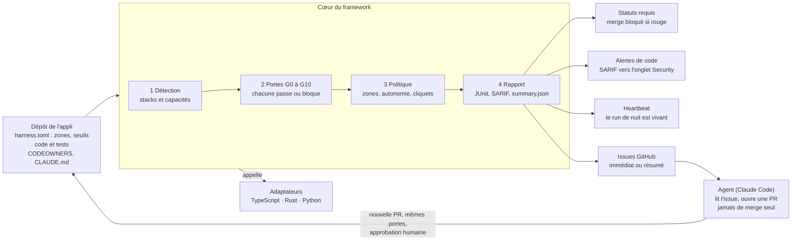

# forge

**Un framework de production fortifiée, applicable à n'importe quel dépôt, par des humains comme par des agents.**

Une « prod parfaite » n'existe pas ; ce qui existe, c'est une prod où rien ne passe sans preuve et où tout problème finit en issue. Ce dépôt orchestre des outils standard plutôt que d'en écrire : onze portes bloquantes (G0 à G10), un manifeste par dépôt, une politique commune pour les agents et les alertes, des seuils en cliquet, et quatre niveaux de maturité pour l'adopter sur n'importe quel dépôt sans tout casser.

- **Ce que contient le dépôt aujourd'hui** : section 1.
- **Le framework** (architecture, portes, manifeste, politique, rapport) : sections 2 à 4.
- **Écrire les tests dans une appli** : section 5.
- **Mise en place sur un dépôt** : section 6.
- **Pourquoi ces choix** (synthèse de la recherche) : section 7. Le détail des étapes, des outils par écosystème et des leçons tirées : [`METHODOLOGY.md`](METHODOLOGY.md).

---

## 1. Ce que contient le dépôt aujourd'hui

Le dépôt couvre déjà les portes G1 à G6 et G8 sous forme de workflows réutilisables et de modèles (détail par porte : [`METHODOLOGY.md`](METHODOLOGY.md)). Le reste est planifié.

| Porte du framework | Où | État |
| --- | --- | --- |
| G0 Hygiène du dépôt | — | Prévu (Scorecard, Conftest, rulesets, CODEOWNERS) |
| G1 Statique | job G1 de `pipeline.yml` | En place |
| G2 Unitaires | job G2 de `pipeline.yml` | En place |
| G3 Intégration + autorisations | job G3 de `pipeline.yml`, `probe` | En place (dépôt pilote) |
| G4 Contrats d'API externes | `nightly.yml` | Modèle, pas encore lancé sur un vrai projet |
| G5 Sécurité | `security.yml`, `sast.yml`, `claude-review.yml`, `dast.yml`, `probe` | En place (`dast.yml` pas encore lancé sur un vrai projet) |
| G6 Bout en bout | job G6 de `pipeline.yml` | Modèle, pas encore lancé sur un vrai projet |
| G7 Mutation | — | Prévu |
| G8 Résilience et charge | `nightly.yml`, `templates/load/` | Modèles, pas encore lancés sur un vrai projet |
| G9 Acceptation cachée | — | Prévu |
| G10 Production | — | Prévu (moniteur externe, heartbeat) |
| Manifeste, politique, rapport unique | — | Prévu (`harness.toml`, zones, `summary.json`) |

### Contenu

| Chemin | Rôle |
| --- | --- |
| `stages/check.mjs` | **Code.** Inspecte n'importe quel dépôt et dit, pour chaque porte (G1 à G6, G8, chaîne), fait / partiel / manquant, puis la suivante. `--json` pour les agents. Première version du futur `harness check` |
| `probe/probe.mjs` | **Code.** Attaque en boîte noire n'importe quelle API HTTP : authentification, données d'un autre utilisateur, chemins hors limites, entrées hostiles, limites de taille, courses, en-têtes, cookies |
| `skills/harden` | Skill Claude Code `/harden` : détecte les portes en place, implémente la suivante, la prouve en CI |
| `.github/workflows/` | CI réutilisable : `security.yml` (gitleaks + audits), `sast.yml` (Semgrep), `dast.yml` (OWASP ZAP), `claude-review.yml`, et `self.yml` qui fait passer ce dépôt par sa propre chaîne |
| `templates/` | `pipeline.yml` (la chaîne de portes), `nightly.yml` (contrats + DAST + charge, ouvre une issue), `dependabot.yml`, modèle de PR, config gitleaks, règles de revue, test de charge k6 |

Les deux outils de code n'ont aucune dépendance (Node 18 ou plus) et ont leurs propres tests (`node --test probe/probe.test.mjs stages/check.test.mjs`), lancés par la CI de ce dépôt avec ses propres workflows de sécurité et SAST.

### L'utiliser

**Avec Claude Code** (une fois par machine) :

```
/plugin marketplace add beskar-ci/forge
/plugin install forge@forge
```

Puis dans n'importe quel projet : `/harden` (ou « amène ce projet au niveau 1 »).

**À la main** :

```sh
node chemin/vers/forge/stages/check.mjs .            # où en suis-je ?
node chemin/vers/forge/probe/probe.mjs app.probe.json  # attaquer l'appli qui tourne
```

Les workflows réutilisables s'appellent ainsi, épinglés sur un SHA de commit (Dependabot propose les mises à jour) :

```yaml
security:
  uses: beskar-ci/forge/.github/workflows/security.yml@<sha>
  permissions: { contents: read, pull-requests: read }
```

Secrets et variables qu'un projet peut demander : `CLAUDE_CODE_OAUTH_TOKEN` (`claude setup-token`) pour la revue, `STAGING_URL` pour le DAST et la charge, identifiants de comptes de test pour les tests de contrat.

### Ce que vérifie `probe`

| Vérification | Échoue quand |
| --- | --- |
| Auth : identifiants absents ou falsifiés | une route marquée `auth` répond autre chose que 401, 403 ou 404 |
| Propriété : autre utilisateur | le second utilisateur lit la ressource du premier (`owned`), ou les données du propriétaire ont changé |
| Sortie de chemin | un `../` encodé, un chemin absolu, un NUL ou un identifiant de 4 Ko n'est pas refusé en 4xx |
| Entrée hostile | des chaînes SQL, HTML ou de template, des chaînes énormes ou des types JSON faux donnent un 5xx ou sont renvoyés tels quels |
| Limite de taille | un corps au-delà de `maxBytes` n'est pas refusé en 4xx |
| Course | plus de `maxSuccess` requêtes sur N en parallèle réussissent |
| En-têtes de sécurité | `nosniff`, `Referrer-Policy`, protection contre le clickjacking, HSTS en https manquent |
| Cookies | un cookie n'a pas HttpOnly, Secure ou SameSite |
| Aucune erreur serveur | une réponse est en 5xx |

Format de configuration : `probe/example.config.json`. À lancer contre le local, une prévisualisation ou staging, jamais contre des données de production.

### Vérifié jusqu'ici

- Les deux outils de code passent leurs tests ; la CI de ce dépôt les lance avec `security.yml` et `sast.yml` sur lui-même.
- Un dépôt pilote privé utilise `security.yml` et `claude-review.yml` d'ici (CI au vert). `probe` y a fait 17 vérifications passées et un vrai constat (pas de protection contre le clickjacking). `stages/check.mjs` y voit G2 et G3 faites, G1 manquante.
- **Pas encore lancés sur un vrai projet :** `dast.yml`, les jobs staging/G6/production de `pipeline.yml`, `nightly.yml`, le modèle k6, la revue Claude sur une vraie PR (il faut le jeton).

---

## 2. Le framework

Un dépôt « harness » unique, branché sur n'importe quelle appli par un fichier de configuration et un workflow de dix lignes : il orchestre des outils existants, rend chaque porte bloquante, et traite les agents comme des contributeurs qui ne peuvent toucher ni à ce qui les juge ni à ce qui les autorise.



L'appli ne déclare que ce que l'outil ne peut pas deviner ; le cœur détecte, exécute les portes via les adaptateurs, applique la politique et publie un seul rapport, d'où partent les statuts, les alertes et les issues qu'un agent peut reprendre, en repassant par les mêmes portes.

### Six principes

1. **Orchestrer, ne pas réécrire.** MegaLinter, Scorecard, Semgrep, Stryker, k6 font déjà leur travail ; le framework les câble.
2. **Une porte bloque ou n'existe pas.** Chaque porte activée est un statut requis dans le ruleset. Un avertissement que personne ne lit n'est pas une porte.
3. **Tout seuil est un cliquet.** Couverture, score de mutation, budget de latence : ils montent, ne descendent jamais, et seul un humain les modifie.
4. **Ce qui juge est hors d'atteinte de ce qui est jugé.** Tests critiques, seuils, workflows et CODEOWNERS sont protégés ; les tests d'acceptation cachés ne sont jamais visibles d'un agent.
5. **Un manifeste par dépôt, une politique pour tous.** L'appli déclare ses zones, son état stable et ses API externes ; les règles d'autonomie et d'alerte vivent dans le cœur.
6. **On adopte sans tout casser.** Sur un dépôt existant, les portes « tiennent la ligne » : elles bloquent les problèmes nouveaux et inventorient l'existant, à résorber ensuite.

### Les portes

| Porte | Ce qu'elle vérifie | Quand | Outils (TS · Rust · Python) |
| --- | --- | --- | --- |
| G0 Hygiène du dépôt | Ruleset actif, CODEOWNERS, dépendances épinglées, aucun secret dans le code | Chaque PR + chaque semaine | OpenSSF Scorecard, gitleaks, Conftest |
| G1 Statique | Format, lint, typage | Avant le commit + chaque PR | MegaLinter ou Trunk ; `tsc` · `clippy` · `mypy` |
| G2 Unitaires | Logique isolée ; couverture en cliquet | Chaque PR | Vitest · `cargo test` · pytest |
| G3 Intégration | Vraie base et services en conteneur ; tests de caractérisation | Chaque PR | Testcontainers, CLI Supabase · `sqlx::test` · pytest |
| G4 Contrats | API externes : réponses enregistrées en PR, vraie API la nuit | Chaque PR + chaque nuit | MSW · `wiremock` · respx ; Pact si on contrôle les deux côtés |
| G5 Sécurité | Failles du code, dépendances vulnérables, appli déployée attaquée | Chaque PR + staging | Semgrep ou CodeQL en SARIF, Dependabot, `cargo audit`, revue Claude (PR de confiance), OWASP ZAP, `probe` |
| G6 Bout en bout | Parcours critiques sur l'environnement de prévisualisation | Chaque PR | Playwright |
| G7 Mutation | Les tests attrapent-ils du code cassé ? Score en cliquet | Incrémental en PR, complet la nuit | Stryker · `cargo-mutants` · mutmut |
| G8 Résilience et charge | L'état stable tient sous pannes injectées et sous charge | Chaque nuit, sur staging | Toxiproxy, k6 ; `turmoil` pour les services Rust conçus pour |
| G9 Acceptation cachée | Tests que l'agent n'a jamais vus | PR d'agent uniquement | Dépôt ou étape protégée |
| G10 Production | Disponibilité, taux d'erreur, tâches planifiées vivantes | En continu | Moniteur externe, alertes sur l'état stable, Healthchecks.io |

---

## 3. Le manifeste, seul fichier propre à chaque appli

Tout ce que l'outil peut détecter (langages, base de données, interface web) n'y figure pas. Il ne contient que les décisions humaines.

```toml
[project]
name = "my-app"
level = 2                      # niveau de maturité visé (section 4)

[zones.protected]              # diagnostic seulement pour les agents
paths = ["supabase/migrations/**", "lib/auth/**", ".github/**", "tests/critical/**", "harness.toml"]

[zones.standard]               # correction sur PR, merge par un humain
paths = ["**"]

[steady_state]                 # réutilisé par k6, Toxiproxy et les alertes de prod
error_rate_max = 0.01
latency_p95_ms = 800

[ratchets]                     # valeurs plancher, relevées automatiquement, jamais baissées
coverage = 72
mutation_critical = 61

[external_apis.shipping]
fixtures = "tests/fixtures/shipping/"
live_check = "nightly"

[environments]
staging = "https://staging.example.app"
preview = "vercel"

[alerts]
channel = "github-issues"
immediate_label = "alert:immediate"
digest_label = "alert:digest"
```

### La politique, commune à tous les dépôts

| Zone | Ce que l'agent peut faire | Qui merge |
| --- | --- | --- |
| Protégée (auth, migrations, secrets, harnais, tests critiques, seuils) | Diagnostiquer et proposer un correctif dans l'issue | Toi, après ta propre PR |
| Standard (code applicatif) | Corriger sur une PR | Toi, après approbation |
| Faible risque (format, lint, dépendances en version patch) | Corriger sur une PR | Merge automatique si tout est vert, seulement après 20 PR d'agent mergées sans retouche ; retour au niveau standard au premier incident |

| Événement | Niveau | Canal |
| --- | --- | --- |
| Prod en panne, erreurs au-dessus de l'état stable | Immédiat | Moniteur externe + issue `alert:immediate` |
| Faille de sécurité confirmée, secret exposé | Immédiat | Issue `alert:immediate` |
| Test RLS ou migration rouge sur `main` | Immédiat | Issue `alert:immediate` |
| Run de nuit ou tâche planifiée absent | Immédiat | Healthchecks.io |
| Agent bloqué après 2 tentatives | Résumé quotidien | Issue `alert:digest` |
| API externe modifiée (prod intacte) | Résumé quotidien | Issue `alert:digest` |
| Vulnérabilité moyenne, cliquet en baisse sur une branche | Résumé quotidien | Issue `alert:digest` |
| Tout le reste | Aucune alerte | Tableau de bord et journaux |

Pas de mot de passe Gmail dans l'infra : les issues GitHub assignées partent par mail toutes seules. Cette politique est écrite en Rego et vérifiée par Conftest à chaque PR : un `harness.toml` qui retire une zone protégée, baisse un cliquet ou désactive une porte fait échouer G0.

### Le rapport unique

Chaque porte, quel que soit l'outil, produit l'un de deux formats standard : JUnit XML pour les tests, SARIF pour les constats. Le cœur y ajoute un `summary.json` par exécution (porte, statut, métriques, valeur des cliquets). De là partent un commentaire unique sur la PR, les alertes dans l'onglet Security, et les issues étiquetées. Les agents ne lisent que `summary.json`, jamais la sortie brute des outils.

### Organisation cible du dépôt et de ce qu'il dépose dans une appli

```
harness/                              mon-app/ (après harness init)
  .github/workflows/                    .github/workflows/harness.yml   ← appelle harness@<sha>
    gate-static.yml  gate-unit.yml      harness.toml
    gate-integration.yml  …             CODEOWNERS
    nightly.yml  agent.yml              CLAUDE.md                       ← méthode spec → test → code
  adapters/typescript|rust|python/      .harness/baseline.json          ← cliquets et existant inventorié
  policy/*.rego  (+ leurs tests)        tests/critical/                 ← protégés
  templates/  rulesets.json
  cli/   harness init | check | run | doctor
```

`harness doctor` compare l'état réel du dépôt GitHub (ruleset, statuts requis, CODEOWNERS, permissions des workflows) à ce que le manifeste exige, et dit ce qui manque. L'actuel `stages/check.mjs` en est la première brique.

---

## 4. Quatre niveaux de maturité

| Niveau | Portes actives | Ce qu'il permet |
| --- | --- | --- |
| 1 Socle | G0, G1, G2, G10 + ruleset + heartbeat | Rien de cassé n'entre ; on sait si la prod et les runs de nuit vivent |
| 2 Intégré | + G3, G4, G5 | Base, API externes et sécurité couvertes ; migration de code possible grâce aux tests de caractérisation |
| 3 Fortifié | + G6, G7, G8, G9 | Les agents peuvent travailler sur le dépôt |
| 4 Simulé | + simulation déterministe | Services Rust conçus pour la DST |

Un agent n'ouvre de PR sur un dépôt qu'à partir du niveau 3 : avant, rien ne garantit que ses tests prouvent quelque chose.

---

## 5. Écrire les tests dans une appli

Le framework fournit les portes ; chaque appli écrit ses propres tests, toujours de la même façon, pour que toi comme un agent sachiez exactement où et comment.

### La méthode, pour chaque fonctionnalité

1. **La spec dans l'issue** : ce que la fonctionnalité doit faire, et ce qu'elle ne doit jamais faire.
2. **Un test qui échoue**, dont le nom est la règle en une phrase.
3. **Le code**, jusqu'à ce que le test passe, sans toucher au test.
4. **La CI** rejoue tout, y compris les anciens tests.
5. **Chaque bug trouvé en prod** devient d'abord un test qui échoue, puis un correctif.

### Où ranger les tests

| Couche | TypeScript | Rust | Python |
| --- | --- | --- | --- |
| Unitaires | `src/**/*.test.ts`, à côté du code | `mod tests` dans le même fichier | `tests/unit/` |
| Intégration | `tests/integration/` | `tests/` (dossier du crate) | `tests/integration/` |
| Critiques, protégés | `tests/critical/` | `tests/critical_*.rs` | `tests/critical/` |
| Réponses d'API enregistrées | `tests/fixtures/<api>/` | `tests/fixtures/<api>/` | `tests/fixtures/<api>/` |
| Bout en bout | `e2e/` | — | — |

### Huit règles pour qu'un test prouve quelque chose

- Un comportement par test, et le nom du test dit lequel.
- Structure fixe : préparer, agir, vérifier.
- Déterministe : pas d'heure réelle, pas de hasard sans graine fixe, pas de réseau dans les tests unitaires.
- Tester le comportement visible, pas l'implémentation : un refactoring ne doit casser aucun test.
- Ne simuler que les frontières externes (API tierces, e-mail, modèles d'IA) ; jamais son propre code.
- Chaque test vérifie au moins une valeur précise ; un test sans vérification fait monter la couverture mais pas le score de mutation.
- Les cas limites d'abord : vide, zéro, négatif, très grand, doublon, accents.
- Les règles critiques (sécurité des données, argent) ont aussi un test par propriétés.

### Un exemple par couche

Unitaire, TypeScript avec Vitest :

```ts
import { describe, it, expect } from "vitest";
import { boxesNeeded } from "./boxes";

describe("boxesNeeded", () => {
  it("arrondit au carton supérieur", () => {
    expect(boxesNeeded({ items: 300, boxSize: 250 })).toBe(2);
  });
  it("renvoie 0 quand il n'y a rien à expédier", () => {
    expect(boxesNeeded({ items: 0, boxSize: 250 })).toBe(0);
  });
});
```

Unitaire, Rust :

```rust
#[cfg(test)]
mod tests {
    use super::*;

    #[test]
    fn arrondit_au_carton_superieur() {
        assert_eq!(boxes_needed(300, 250), 2);
    }
}
```

Par propriétés, Rust avec `proptest` : la règle est vérifiée sur des centaines de valeurs générées.

```rust
use proptest::prelude::*;

proptest! {
    #[test]
    fn assez_de_cartons_jamais_un_de_trop(items in 0u32..100_000, size in 1u32..5_000) {
        let n = boxes_needed(items, size);
        prop_assert!(n * size >= items);
        prop_assert!(n == 0 || (n - 1) * size < items);
    }
}
```

Intégration, Rust avec `sqlx::test` : chaque test reçoit une base neuve, migrations appliquées.

```rust
#[sqlx::test]
async fn un_utilisateur_ne_lit_pas_la_commande_d_un_autre(pool: PgPool) {
    let (alice, bob) = seed_two_users(&pool).await;
    let order = create_order(&pool, alice).await;
    assert!(get_order(&pool, bob, order.id).await.is_err());
}
```

Contrat, TypeScript avec MSW : l'API externe répond avec une réponse enregistrée.

```ts
import { http, HttpResponse } from "msw";
import { setupServer } from "msw/node";
import quote from "../fixtures/shipping/quote-small-parcel.json";

const server = setupServer(
  http.get("https://api.example.com/quote", () => HttpResponse.json(quote)),
);
beforeAll(() => server.listen({ onUnhandledRequest: "error" }));
afterAll(() => server.close());
```

Caractérisation, TypeScript : on fige la sortie actuelle avant de modifier le code.

```ts
it("la facture calculée ne change pas", () => {
  expect(buildInvoice(orderFixture)).toMatchSnapshot();
});
```

Bout en bout, Playwright :

```ts
test("importer un fichier CSV crée des lignes de commande", async ({ page }) => {
  await page.goto("/");
  await page.getByLabel("Fichier").setInputFiles("e2e/fixtures/orders.csv");
  await page.getByRole("button", { name: "Importer" }).click();
  await expect(page.getByTestId("order-line")).not.toHaveCount(0);
});
```

### Ce que dit `CLAUDE.md` à l'agent

- Lire la spec de l'issue ; si elle manque ou se contredit, ouvrir `agent:blocked` au lieu de deviner.
- Écrire d'abord le test qui échoue, au bon endroit selon le tableau ci-dessus.
- Ne jamais modifier, supprimer ou désactiver un test existant pour faire passer une porte ; si un test semble faux, ouvrir `agent:blocked`.
- Ne jamais toucher aux zones protégées ni à `harness.toml`.
- Lancer les portes en local avant d'ouvrir la PR, et joindre `summary.json` à la description.

---

## 6. Mise en place sur un dépôt

L'ordre compte : on rend les portes obligatoires avant d'en ajouter, et on n'ouvre le dépôt aux agents qu'en dernier.

**Niveau 1, le premier jour**

- [ ] Rendre le dépôt public, ou passer sur un compte GitHub Pro (rulesets et CODEOWNERS obligatoires sur dépôt privé)
- [ ] Ajouter le manifeste, le workflow appelant épinglé sur un SHA, CODEOWNERS et `CLAUDE.md`
- [ ] Remplir les zones protégées du manifeste ; CODEOWNERS couvre `/.github/`, `harness.toml`, `tests/critical/` et lui-même
- [ ] Ruleset sur `main` : PR obligatoire, statuts G0 à G2 requis, revue des code owners obligatoire, approbation annulée si le code change
- [ ] Workflows en permissions minimales par défaut (`contents: read`), élargies job par job
- [ ] Inventorier l'existant dans `.harness/baseline.json` pour tenir la ligne
- [ ] Moniteur de disponibilité externe sur la prod ; une vérification Healthchecks.io par tâche planifiée
- [ ] Vérification de conformité du dépôt (`stages/check.mjs`, puis `harness doctor`) au vert

**Niveau 2**

- [ ] Tests de caractérisation sur le code existant qui compte, avant toute refonte
- [ ] Intégration sur une vraie base en conteneur ; tests de sécurité des données (RLS ou équivalent) dans `tests/critical/`
- [ ] Réponses enregistrées pour chaque API externe + vérification nocturne contre la vraie API
- [ ] Semgrep ou CodeQL en SARIF, Dependabot, gitleaks, revue de sécurité Claude sur les PR de confiance, `probe` contre la prévisualisation

**Niveau 3, avant le premier agent**

- [ ] Playwright sur les parcours critiques, contre l'environnement de prévisualisation
- [ ] Mutation en cliquet sur les zones protégées ; score de départ un peu sous le score actuel
- [ ] État stable déclaré ; k6 et scénarios Toxiproxy chaque nuit sur staging
- [ ] Tests d'acceptation cachés dans un dépôt privé séparé, lancés sur les PR d'agent
- [ ] GitHub App dédiée à l'agent, limitée aux contenus, issues et PR ; ses approbations ne comptent pas
- [ ] Canal d'escalade dans `CLAUDE.md` : en cas de test qu'il croit faux ou de tâche impossible, l'agent ouvre une issue `agent:blocked` au lieu de toucher au test

**Ensuite, chaque mois**

- [ ] Relever les cliquets atteints
- [ ] Relire les PR d'agent fusionnées et décider si une catégorie mérite le merge automatique
- [ ] Restaurer une sauvegarde sur staging, faire un rollback, faire tourner une clé

---

## 7. Pourquoi ces choix

Synthèse de la recherche qui fonde le framework (novembre 2026).

**Les outils existants.** [MegaLinter](https://megalinter.io) lance des dizaines de linters dans n'importe quelle CI, avec des « flavors » par type de projet : c'est le modèle des profils par stack. [Trunk Check](https://docs.trunk.io/check/configuration/hold-the-line) ne signale que les problèmes nouveaux d'un changement (*hold-the-line*), le principe qui permet d'adopter le framework sur un dépôt existant. [OpenSSF Scorecard](https://github.com/ossf/scorecard) note la sécurité d'un dépôt (protection de branche, revue, dépendances épinglées, SAST) : c'est déjà la moitié de G0. Le framework orchestre ces outils au lieu de les réécrire.

**L'architecture.** Les [workflows réutilisables](https://docs.github.com/en/actions/reference/workflows-and-actions/reusing-workflow-configurations) (`on: workflow_call`) laissent chaque appli appeler la chaîne en une ligne ; les épingler par SHA garantit que tout le monde exécute le même code. [SARIF](https://docs.github.com/en/code-security/concepts/code-scanning/sarif-files), standard OASIS lu nativement par GitHub, réunit les constats de tous les outils au même endroit. [Conftest](https://github.com/open-policy-agent/conftest) vérifie des règles écrites en Rego sur n'importe quel fichier de configuration. Les [rulesets](https://docs.github.com/en/repositories/configuring-branches-and-merges-in-your-repository/managing-rulesets/available-rules-for-rulesets) rendent les portes obligatoires ; un statut requis peut être exigé d'une GitHub App précise, et une approbation est annulée si le code change. Sur un dépôt privé, rulesets et CODEOWNERS obligatoires demandent GitHub Pro.

**Les tests.** Pour une appli web, le [« trophée » de Kent C. Dodds](https://kentcdodds.com/blog/the-testing-trophy-and-testing-classifications) remplace la pyramide : statique, unitaires, une couche d'intégration plus épaisse, peu de bout en bout. Les [tests de caractérisation](https://en.wikipedia.org/wiki/Characterization_test) (Michael Feathers) figent le comportement existant avant une refonte ; ils ne disent pas si le code est juste, seulement s'il a changé. [Pact](https://docs.pact.io/implementation_guides/javascript/docs/consumer) formalise les contrats entre consommateur et fournisseur ; pour une API tierce, on garde l'idée avec des réponses enregistrées et une vérification nocturne. Le score de mutation mesure ce que la couverture ne mesure pas : ce qui est vraiment vérifié. Les seuils se règlent un peu sous le score actuel, ne baissent jamais, et la passe complète tourne la nuit ([Stryker](https://stryker-mutator.io/blog/stryker-0-8-0/), [CircleCI](https://circleci.com/blog/what-is-mutation-testing/)).

**La résilience.** La simulation déterministe de FoundationDB ([Will Wilson, Strange Loop 2014](https://thestrangeloop.com/2014/testing-distributed-systems-w-slash-deterministic-simulation.html)) exige un système conçu pour elle dès le départ ([Antithesis](https://antithesis.com/resources/deterministic_simulation_testing/)) : profil optionnel pour les services Rust, pas une porte générale. Pour une appli classique, [Toxiproxy](https://github.com/Shopify/toxiproxy) injecte latence, coupures et resets entre l'appli et ses dépendances. Les [principes du chaos engineering](https://principlesofchaos.org/) disent comment mener ces expériences autour d'un « état stable » mesurable, et les [seuils k6](https://grafana.com/docs/k6/latest/using-k6/thresholds/) font échouer la CI quand cet état n'est pas tenu.

**Les agents.** Un agent qui doit faire passer des tests peut les modifier, coder en dur les résultats attendus ou trafiquer le lanceur : le *reward hacking* ([Qodo](https://www.qodo.ai/?p=23012)). Les parades : tests de confiance exécutés hors de sa portée ([source](https://www.vincentschmalbach.com/how-to-stop-a-coding-agent-from-weakening-or-faking-tests-to-make-them-pass/)), tests d'acceptation cachés ([source](https://dev.to/penloom_studio_829b7817d3/your-ai-agent-will-pass-any-test-its-allowed-to-edit-51fo)), CODEOWNERS avec revue obligatoire ([GitHub](https://docs.github.com/en/repositories/managing-your-repositorys-settings-and-features/customizing-your-repository/about-code-owners), [Microsoft Learn](https://learn.microsoft.com/en-gb/training/modules/governance-guardrails-operations/3-enforce-governance-github-controls)), approbations humaines seules, et un canal pour dire « je suis bloqué » : dans une étude de 2026 sur 8 modèles, outil d'escalade et consigne claire ont fait passer la triche de 23,6 % à 5,3 % des tâches ([arXiv](https://arxiv.org/pdf/2608.29460)). La [Claude Code GitHub Action](https://code.claude.com/docs/en/github-actions) gagne à tourner avec une GitHub App aux permissions minimales ; [Claude Code Security Review](https://github.com/anthropics/claude-code-security-review) n'est pas durcie contre l'injection de prompt et ne doit relire que des PR de confiance, en complément de Semgrep ou CodeQL.

**Les alertes.** Une alerte qui réveille doit être urgente, importante, actionnable et réelle ([Rob Ewaschuk](https://docs.google.com/document/d/199PqyG3UsyXlwieHaqbGiWVa8eMWi8zzAn0YfcApr8Q/mobilebasic)), porter sur les symptômes et non les causes ([SRE book](https://sre.google/sre-book/monitoring-distributed-systems/)), et se ranger en trois niveaux : agir maintenant, agir plus tard, ne rien faire ([SREcon 2016](https://www.usenix.net/sites/default/files/conference/protected-files/srecon16europe_slides_rabenstein.pdf)). Avec de vrais utilisateurs, on alerte sur le taux de combustion du budget d'erreur, avec une fenêtre longue et une courte ([SRE Workbook](https://sre.google/workbook/alerting-on-slos/)). Un *dead man's switch* détecte la tâche qui ne tourne plus du tout ; Healthchecks.io est open source et gratuit jusqu'à 20 tâches ([comparatif](https://www.productcompass.pm/p/cron-job-monitoring)), avec un délai de grâce réglé tâche par tâche ([openstatus](https://www.openstatus.dev/guides/what-is-a-cron-heartbeat-monitor)).
